# MATHEMATICAL MODELLING, SIMULATION AND ANALYSIS OF A 3D X-Y CART WITH AN INVERTED SPHERICAL PENDULUM

**Final Technical Research Report**

**Project scope:** Nonlinear modelling, numerical simulation, multibody implementation, dynamic analysis and LQR stabilization

---

# Abstract

This project investigates a three-dimensional inverted spherical pendulum mounted on a cart capable of independent translation along two horizontal axes. Unlike a conventional planar cart-pole, the cart moves in the X-Y plane and the pendulum bob moves in three-dimensional space. The system is described by four mechanical degrees of freedom: two cart translations, pendulum inclination and pendulum azimuth.

A nonlinear mathematical model was developed using the Lagrangian formulation. Numerical implementations were developed in MATLAB, Simulink and Simscape Multibody. Model verification included mechanical energy conservation, rod-length constraint checks and rotational symmetry analysis. Uncontrolled dynamic behaviour and parameter sensitivity were studied, including an 81-case combined parameter investigation and second-order regression with leave-one-out cross-validation.

An LQR controller was designed using a local state-space representation and implemented with componentwise force saturation. The controller was evaluated under parameter variations, initial-condition variations and large initial pendulum inclinations. Under the tested 15-second simulation conditions, the largest initial inclination satisfying all settling criteria was 46.6 degrees, while the smallest tested failing inclination was 46.7 degrees.

The results demonstrate successful nonlinear modelling, numerical verification, cross-platform implementation and closed-loop stabilization within the tested operating conditions. Limitations include the absence of a physical cart travel constraint and the restricted scope of the empirical stabilization boundary.

**Keywords:** inverted spherical pendulum, X-Y cart, nonlinear dynamics, Lagrangian mechanics, MATLAB, Simulink, Simscape Multibody, LQR control, sensitivity analysis.

---

# 1. Introduction

An inverted pendulum is a nonlinear mechanical system whose upright configuration is unstable without suitable control. It is widely used to investigate dynamic modelling, stabilization and control of underactuated mechanical systems.

This project extends the conventional cart-pole arrangement to three-dimensional motion. The cart translates independently in two horizontal directions, while a pendulum rod connected through a spherical joint can change its inclination and azimuth.

The resulting system exhibits coupling between cart translation and pendulum rotation. Its dynamics cannot be represented adequately by a conventional single-plane cart-pole model.

## 1.1 Objectives

The principal objectives are:

1. Develop a nonlinear mathematical model of the three-dimensional X-Y cart and inverted spherical pendulum.
2. Derive the equations of motion using Lagrangian mechanics.
3. Implement the model in MATLAB and examine its open-loop response.
4. Develop corresponding Simulink and Simscape Multibody implementations.
5. Verify physical constraints and mechanical energy behaviour.
6. Investigate parameter sensitivity, initial-condition effects and force response.
7. Design and implement an LQR controller.
8. Evaluate controller robustness and empirically characterize its tested stabilization boundary.

## 1.2 System Configuration

The system consists of a cart of mass M, a massless rigid rod of length L and a point-mass bob of mass m. The cart pivot is restricted to the horizontal X-Y plane. The rod extends upward from the cart, and gravity acts in the negative Z direction.

## 1.3 Baseline Parameters

| Parameter | Symbol | Baseline value |
|---|---:|---:|
| Cart mass | M | 2.0 kg |
| Bob mass | m | 0.5 kg |
| Rod length | L | 1.0 m |
| Gravitational acceleration | g | 9.81 m/s² |
| X-direction external force | Fx | 0 N |
| Y-direction external force | Fy | 0 N |
| Initial inclination | theta₀ | 5 degrees |
| Initial azimuth | phi₀ | 30 degrees |
| Simulation duration | T | 15 s |

---

# 2. Mathematical Modelling

## 2.1 Modelling Assumptions

The mathematical model uses the following assumptions:

- The cart is a rigid body.
- The pendulum rod is rigid and massless.
- The bob is represented as a point mass.
- The spherical joint is ideal and frictionless.
- Gravity is uniform and constant.
- Cart translation is restricted to the horizontal X-Y plane.
- The rod length remains constant.
- Friction and mechanical damping are neglected in the baseline model.
- External forces act along the cart X and Y directions.

## 2.2 Generalized Coordinates

The generalized coordinate vector is

\[
q = [x,\ y,\theta,\phi]^T.
\]

Here, x and y are cart positions, theta is inclination measured from the upward vertical, and phi is azimuth measured from the positive X direction towards positive Y.

The angular first-order state vector is

\[
z = [x,y,\theta,\phi,\dot{x},\dot{y},\dot{\theta},\dot{\phi}]^T.
\]

The system therefore has four mechanical degrees of freedom and eight first-order state variables in this angular representation.

## 2.3 Position of the Bob

The cart pivot position is

\[
r_c = [x,y,0]^T.
\]

The bob position relative to the cart is

\[
r_{rel} =
\begin{bmatrix}
L\sin\theta\cos\phi \\\
L\sin\theta\sin\phi \\\
L\cos\theta
\end{bmatrix}.
\]

Thus, the absolute bob position is

\[
r_p =
\begin{bmatrix}
x+L\sin\theta\cos\phi \\\
y+L\sin\theta\sin\phi \\\
L\cos\theta
\end{bmatrix}.
\]

## 2.4 Energy Formulation

The total kinetic energy is the sum of cart and bob kinetic energies:

\[
T = \frac{1}{2}M(\dot{x}^2+\dot{y}^2)
+\frac{1}{2}m\,v_p^Tv_p.
\]

The gravitational potential energy, referenced to the cart pivot height, is

\[
V=mgL\cos\theta.
\]

The Lagrangian is

\[
\mathcal{L}=T-V.
\]

## 2.5 Equations of Motion

The equations are obtained from the Euler-Lagrange equations:

\[
\frac{d}{dt}\left(\frac{\partial\mathcal{L}}{\partial\dot q_i}\right)
-\frac{\partial\mathcal{L}}{\partial q_i}=Q_i.
\]

With generalized force vector

\[
Q=[F_x,F_y,0,0]^T,
\]

the equations can be collected into the form

\[
M(q)\ddot q=R(q,\dot q,F_x,F_y).
\]

The angular mass matrix is symmetric. The acceleration solution is evaluated numerically using a linear system solve rather than explicitly forming the matrix inverse.

### Explicit Angular Mass Matrix and Nonlinear RHS

The angular equations implemented in MATLAB are

\[
M(q)\ddot{q}=R(q,\dot{q},F_x,F_y).
\]

The symmetric mass matrix is

\[
\begin{bmatrix}
(M+m) & 0 & mL\cos\theta\cos\phi & -mL\sin\theta\sin\phi \\
0 & (M+m) & mL\cos\theta\sin\phi & mL\sin\theta\cos\phi \\
mL\cos\theta\cos\phi & mL\cos\theta\sin\phi & mL^2 & 0 \\
-mL\sin\theta\sin\phi & mL\sin\theta\cos\phi & 0 & mL^2\sin^2\theta
\end{bmatrix}
\]

The nonlinear right-hand-side vector is

\[
\begin{bmatrix}
F_x+mL\sin\theta\cos\phi(\dot{\theta}^2+\dot{\phi}^2)+2mL\cos\theta\sin\phi\dot{\theta}\dot{\phi} \\
F_y+mL\sin\theta\sin\phi(\dot{\theta}^2+\dot{\phi}^2)-2mL\cos\theta\cos\phi\dot{\theta}\dot{\phi} \\
mL^2\sin\theta\cos\theta\dot{\phi}^2+mgL\sin\theta \\
-2mL^2\sin\theta\cos\theta\dot{\theta}\dot{\phi}
\end{bmatrix}
\]

The generalized accelerations are obtained by solving this linear system at each evaluation of the equations of motion. Gravity appears explicitly in the inclination equation.

## 2.6 Coordinate Singularity

The angular mass matrix determinant is proportional to sin²(theta). The azimuth coordinate becomes undefined when the rod is vertically aligned. This is a spherical-coordinate singularity, not a physical loss of a mechanical degree of freedom.

For control near the upright position, a local Cartesian relative-position representation is used instead of relying on the azimuth coordinate at the singular configuration.

---

# 3. Numerical Model Implementations

## 3.1 MATLAB Angular Formulation

The angular model uses the four generalized coordinates and their four velocities. It provides the Lagrangian formulation and supports verification of the derived equations.

## 3.2 MATLAB Cartesian Formulation

A constrained Cartesian representation is also implemented. Its state vector is

\[
z_c=[x,y,X,Y,Z,\dot{x},\dot{y},\dot{X},\dot{Y},\dot{Z}]^T.
\]

Here, (X,Y,Z) represents the bob position and the rod-length constraint is

\[
(X-x)^2+(Y-y)^2+Z^2=L^2.
\]

This formulation has ten state variables and an algebraic mechanical constraint. It is distinct from the eight-state angular formulation and must not be confused with a system having ten independent degrees of freedom.

## 3.3 Simulink Implementation

The nonlinear controlled system was also implemented in Simulink. The controlled simulation produced a response consistent with the MATLAB controlled model. The recorded comparison between MATLAB and Simulink gave an RMS state error of approximately 2.0094 × 10⁻⁷ and a maximum error of approximately 1.2137 × 10⁻⁵ in the reported state comparison.

## 3.4 Simscape Multibody Implementation

The multibody model includes the world and mechanism environment, two orthogonal prismatic cart joints, the cart assembly, a spherical pendulum connection, rod, bob, sensors and actuators. A controlled copy of the mechanical model was used for closed-loop testing.

---

# 4. Model Verification and Validation

## 4.1 MATLAB Numerical Verification

The baseline uncontrolled MATLAB Cartesian simulation used 1,501 samples over 15 seconds. The maximum rod-length error was approximately 8.59 × 10⁻¹¹ m. The maximum mechanical energy balance error was approximately 3.13 × 10⁻⁸ J.

The uncontrolled pendulum inclination increased from 5 degrees to approximately 83.8006 degrees over the 15-second simulation, demonstrating the open-loop departure from the upright configuration.

## 4.2 Simscape Energy Conservation

The uncontrolled Simscape energy validation produced the following results:

| Measurement | Result |
|---|---:|
| Initial mechanical energy | 4.8912213291 J |
| Final mechanical energy | 4.8912270304 J |
| RMS energy drift | 0.00003779 J |
| Maximum energy drift | 0.00024947 J |
| Maximum relative energy drift | 0.00510038% |

These results demonstrate good energy conservation for the simulated unforced and undamped mechanical model.

## 4.3 MATLAB–Simscape Comparison

The independent MATLAB and Simscape uncontrolled models showed strong agreement during the initial 0–3 second transient. The reported RMS errors over this interval were 0.000320 m for cart position, 0.001562 m for bob absolute position and 0.075662 degrees for inclination.

Full 15-second trajectory agreement was not established. The open-loop inverted pendulum is unstable, so small numerical and model differences can grow over time. Azimuth is also sensitive when the horizontal projection of the rod becomes small. The short-term agreement should therefore not be generalized to the full simulation duration.

## 4.4 Controlled Model Comparison

The controlled MATLAB and Simscape results showed close agreement. The reported RMS errors included approximately 2.0714 × 10⁻⁵ m for cart position, 1.4410 × 10⁻⁵ m for bob position, 3.2341 × 10⁻⁶ m for relative position and 5.316 × 10⁻⁴ degrees for inclination.

---

# 5. Uncontrolled Dynamic Analysis

## 5.1 Upright Equilibrium Behaviour

The exact upright configuration remains stationary in the ideal mathematical model when initialized exactly at equilibrium. Small perturbations, however, lead to rapid departure from the upright position. For example, a 0.1-degree initial perturbation reached 90 degrees of inclination after approximately 2.19 seconds in the reported test.

These finite-time simulations demonstrate the unstable open-loop response. They are numerical trajectory evidence and are not, by themselves, a formal eigenvalue proof of instability.

## 5.2 Parameter Sensitivity

The study investigated cart mass, bob mass, rod length and gravitational acceleration. In the combined parameter study, the tested levels were:

| Parameter | Tested levels |
|---|---|
| Cart mass | 1, 2, 3 kg |
| Bob mass | 0.25, 0.50, 0.75 kg |
| Rod length | 0.5, 1.0, 1.5 m |
| Applied X force | 0.5, 1.0, 1.5 N |

A total of 81 combined cases were evaluated. Within this parameter grid, external force and cart mass were the dominant factors in the reported cart displacement and speed responses. Rod length had a comparatively small main-effect contribution in that particular study.

## 5.3 Global Sensitivity

The reported eta-squared main-effect measures were:

| Parameter | Cart displacement | Cart speed | Inclination |
|---|---:|---:|---:|
| Cart mass | 0.385905 | 0.473683 | 0.302721 |
| Bob mass | 0.032553 | 0.010788 | 0.037390 |
| Rod length | 0.000001 | 0.000217 | 0.000619 |
| External force | 0.493743 | 0.420687 | 0.294362 |

These are main-effect measures from the studied parameter grid. They should not be interpreted as independent additive shares of total response variance when interactions are present.

## 5.4 Regression and Cross-Validation

A second-order regression model was fitted using the 81-case parameter study. Leave-one-out cross-validation produced the following results:

| Response | LOOCV R² | LOOCV RMSE | LOOCV MAE |
|---|---:|---:|---:|
| Maximum cart displacement | 0.98751731 | 3.33159439 m | 2.49241181 m |
| Maximum cart speed | 0.96750879 | 0.69521462 m/s | 0.51345884 m/s |
| Maximum inclination | 0.65717051 | 0.60037956 degrees | 0.45120801 degrees |

The displacement and speed models show strong predictive performance within the tested grid. Inclination prediction is less accurate. Leave-one-out validation assesses interpolation within the sampled design and does not establish reliable extrapolation outside the tested parameter ranges.

---

# 6. LQR Controller Design

## 6.1 Local Control Coordinates

To avoid the angular-coordinate singularity near the upright configuration, the controller uses local relative-position coordinates. The controller state is

\[
s=[x,y,\xi,\eta,\dot{x},\dot{y},\dot{\xi},\dot{\eta}]^T,
\]

where xi and eta are the horizontal relative bob coordinates with respect to the cart, and their time derivatives are the corresponding relative velocities.

## 6.2 LQR Formulation

The linearized local model is represented by

\[
\dot{s}=As+Bu.
\]

The quadratic performance index is

\[
J=\int_0^\infty(s^TQs+u^TRu)\,dt.
\]

The design used

\[
Q=\operatorname{diag}(10,10,500,500,2,2,20,20),
\]

\[
R=\operatorname{diag}(0.5,0.5).
\]

The resulting gain has dimensions 2 × 8. The controllability rank of the linearized model was 8, and the reported Riccati residual norm was approximately 1.92 × 10⁻¹⁰.

### Calculated LQR Gain Matrix

The calculated gain matrix, rounded to four decimal places, is

\[
K=\begin{bmatrix}
-4.4721 & 0 & -99.4112 & 0 & -8.5016 & 0 & -29.0870 & 0 \\
0 & -4.4721 & 0 & -99.4112 & 0 & -8.5016 & 0 & -29.0870
\end{bmatrix}.
\]

The feedback law is \(u=-Ks\). The two rows generate the X- and Y-axis cart forces, respectively. The controller independently saturates each force component to the interval [-30,30] N.

## 6.3 Control Law and Saturation

The unconstrained control command is

\[
u=-Ks.
\]

Each force component is saturated independently at ±30 N. This is a componentwise model limit, not a constraint on the Euclidean norm of the two-dimensional force vector and not evidence of a physically tested actuator.

---

# 7. Controlled Simulation Results

## 7.1 Baseline Response

The baseline controlled MATLAB simulation used an initial inclination of 5 degrees and azimuth of 30 degrees. Over 15 seconds, the final inclination was approximately 0.00003346 degrees.

| Measurement | Baseline result |
|---|---:|
| Initial inclination | 5 degrees |
| Final inclination | 0.00003346 degrees |
| Maximum cart displacement | 0.262601 m |
| Maximum cart speed | 0.417776 m/s |
| Maximum absolute X force | 7.503466 N |
| Maximum absolute Y force | 4.332128 N |
| Maximum rod-length error | 1.35 × 10⁻¹² m |

The controller successfully returned the pendulum close to the upright configuration while keeping both force components below the model saturation limits in the baseline case.

## 7.2 Parameter Robustness

The fixed baseline gain was evaluated over the following individual parameter ranges:

- Cart mass: 1.0–3.0 kg.
- Bob mass: 0.25–0.75 kg.
- Rod length: 0.50–1.50 m.
- Gravity: 7.81–11.81 m/s².

The tested individual parameter variations were stabilized by the fixed-gain controller in the reported simulations. This demonstrates robustness over the tested cases, not for arbitrary parameter combinations.

## 7.3 Initial-Condition Robustness

The initial-condition studies included inclination from 1 to 10 degrees, azimuth from 0 to 120 degrees, cart initial velocities from −0.2 to +0.2 m/s, and initial angular rates from −0.5 to +0.5 rad/s. The tested cases were evaluated for stabilization, cart motion, rod constraint and control force.

## 7.4 Stabilization Boundary Investigation

The large-inclination investigation progressively refined the tested initial-angle range. The fine boundary and settling verification identified the following result:

| Initial inclination | Settling classification |
|---|---|
| 46.6 degrees | Pass |
| 46.7 degrees | Fail |

The settling criteria required all of the following during the final second of the 15-second simulation:

1. Maximum inclination below 0.01 degrees.
2. Maximum bob angular speed below 0.001 rad/s.
3. Final cart speed below 0.01 m/s.

At 46.6 degrees, the final-second maximum inclination was approximately 0.0016066 degrees, maximum angular speed was approximately 1.4049 × 10⁻⁵ rad/s, and final cart speed was approximately 8.2985 × 10⁻⁵ m/s. The 46.7-degree case failed the settling criteria.

This brackets the tested settling transition between 46.6 and 46.7 degrees for the specified initial azimuth, zero initial velocities, fixed gain, 15-second horizon and componentwise force saturation. It is an empirical result for those conditions, not a universal nonlinear stability boundary.

Large failed-case cart displacements are mathematical outputs of the model. The simulations do not include a finite rail or cart-travel limit, so those trajectories should not be interpreted as physically achievable travel.

---

# 8. Comparative Animation

A controlled-versus-uncontrolled 3D comparison animation was regenerated from the saved MATLAB simulation results. No physics simulation was rerun for this recovery.

| Video property | Verified value |
|---|---:|
| Format | Motion JPEG AVI |
| Duration | 15.02 s |
| Frame rate | 50 FPS |
| Resolution | 1450 × 900 pixels |
| Decoded frames | 751 |
| File size | 128.23 MB |
| Integrity verification | Passed |

The animation compares the uncontrolled and controlled trajectories and includes inclination and control-force plots.

---

# 9. Discussion

The project establishes a consistent modelling and simulation workflow for a three-dimensional inverted spherical pendulum on a two-axis cart. The nonlinear model captures coupling between cart translation and pendulum motion. The Cartesian constrained model provides a useful representation for numerical simulation and control implementation near the upright configuration.

The energy and rod-length checks provide quantitative evidence of numerical consistency. The Simscape energy results demonstrate good conservation for the ideal unforced system. Independent MATLAB and Simscape models agree well during the initial uncontrolled transient, while long-term uncontrolled trajectory differences remain expected for an unstable system and must be acknowledged.

The parameter study identifies cart mass and applied force as important contributors to cart displacement and speed over the sampled design. The regression results support prediction within the studied parameter grid, particularly for displacement and speed, but are weaker for inclination.

The LQR controller stabilizes the baseline and the tested robustness cases. The large-angle study shows that actuator saturation becomes important and that successful settling is sensitive to initial inclination near the observed transition. The empirical boundary must be interpreted together with the specific initial conditions, simulation horizon and force limits.

---

# 10. Limitations

The principal limitations are:

1. The baseline mechanical model neglects friction, damping, joint losses and actuator dynamics.
2. The rod is treated as massless and the bob as a point mass.
3. No finite cart rail or travel boundary is included.
4. The 30 N limits are ideal componentwise saturation limits in the controller model.
5. The uncontrolled MATLAB–Simscape full-duration trajectory agreement is partial rather than complete.
6. Regression validation is limited to leave-one-out interpolation within the 81-case parameter grid.
7. The 46.6–46.7 degree stabilization transition is empirical and applies only to the tested conditions.
8. Simulation results do not replace experimental validation on a physical prototype.

---

# 11. Conclusions

A nonlinear model of a three-dimensional X-Y cart with an inverted spherical pendulum was developed and implemented using angular and Cartesian formulations. The system has four mechanical degrees of freedom, with the Cartesian constrained implementation represented by ten first-order state variables.

MATLAB, Simulink and Simscape Multibody implementations were developed and evaluated. Numerical checks demonstrated small rod-length error and good energy conservation. The Simscape model showed strong short-term agreement with the independent MATLAB uncontrolled model, while full-duration uncontrolled agreement remained partial.

The uncontrolled analysis included parameter sensitivity, rotational symmetry, energy behaviour, external-force response and an 81-case combined parameter study. Second-order regression and leave-one-out validation produced strong predictive performance for cart displacement and speed within the tested parameter grid, with lower accuracy for inclination.

An LQR controller was designed and implemented with independent ±30 N force saturation in each cart axis. The controller stabilized the baseline and the tested parameter and initial-condition cases. Under the specified settling criteria and test conditions, 46.6 degrees was the largest verified settling inclination and 46.7 degrees was the smallest tested failing inclination.

Overall, the project demonstrates a complete numerical investigation of a three-dimensional inverted spherical pendulum system, from nonlinear modelling and multibody simulation to dynamic analysis and feedback stabilization.

---

# 12. Future Work

Future development should consider:

- Experimental validation using a physical X-Y cart and spherical pendulum prototype.
- Inclusion of cart rail limits, friction, damping and actuator dynamics.
- Robust, nonlinear or model-predictive control for larger operating regions.
- Further analysis of saturation duration and actuator energy consumption.
- Adaptive or gain-scheduled control for parameter variations.
- Additional validation using independent numerical solvers and experimental measurements.
- Regression testing on additional parameter samples and external validation cases.

---

# 13. Project Reproducibility and Result Records

The project retains the phase-specific MATLAB scripts, Simulink and Simscape models, result MAT files, CSV records and figures. The Phase 11.6 master consolidation package loaded all 14 expected source result files with zero missing files.

Key consolidated result:

`Results/Phase_11/phase_11_6_master_project_results.mat`

Source manifest:

`Results/Phase_11/Phase_11_6_MasterResults_SourceManifest.csv`

Consolidation report:

`Results/Phase_11/Phase_11_6_Final_Results_Consolidation_Report.txt`

---

# Appendix A. Selected Project Figures

The following existing figures are recommended for inclusion in the final formatted report. Paths are relative to the project root.

## A.1 Three-model validation

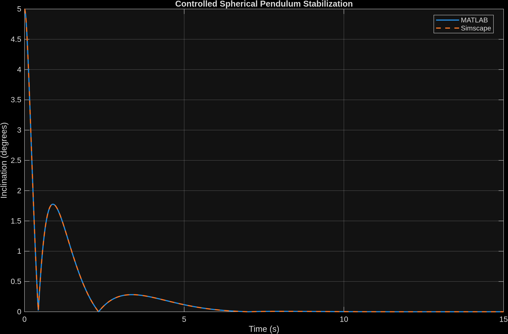

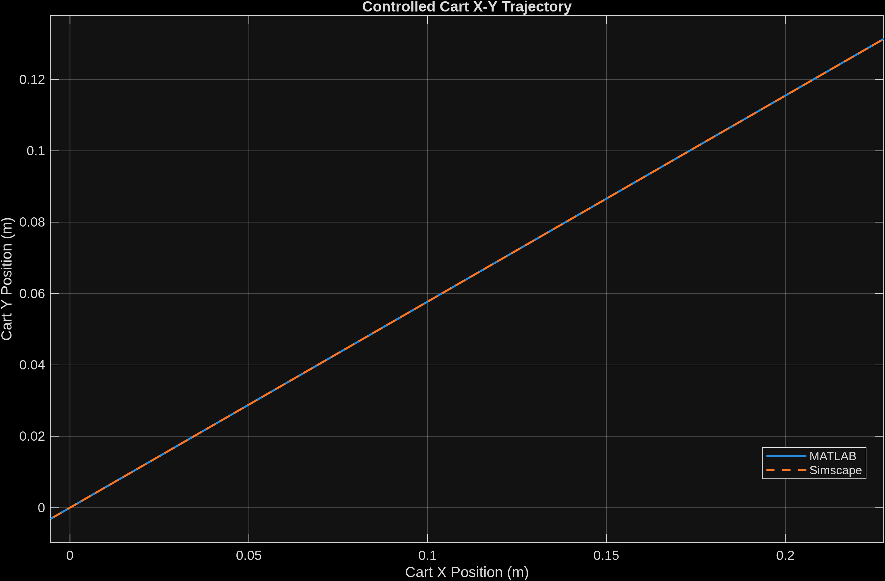

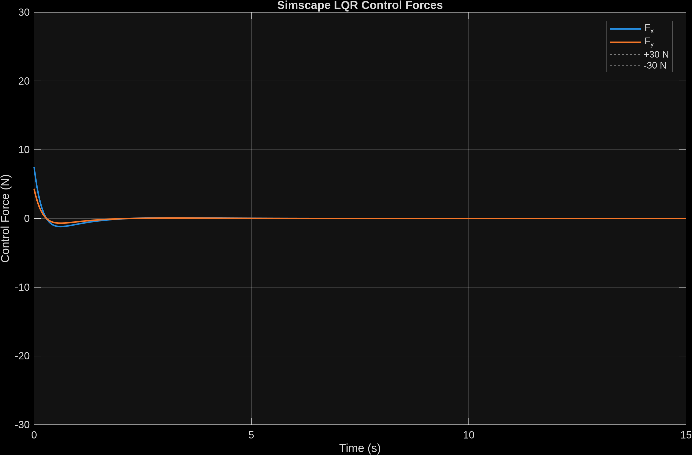

## A.2 Uncontrolled dynamics and energy

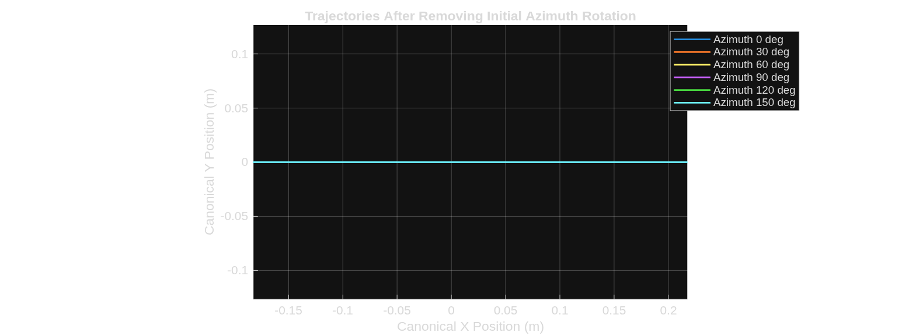

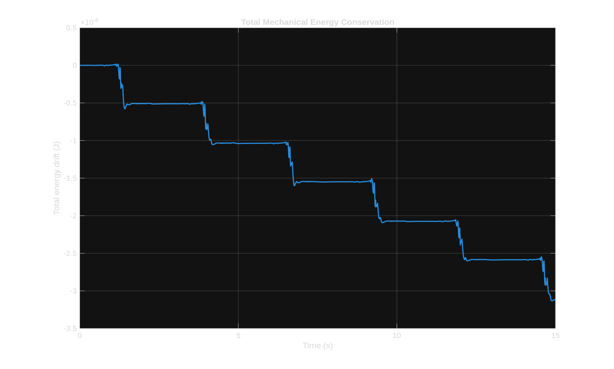

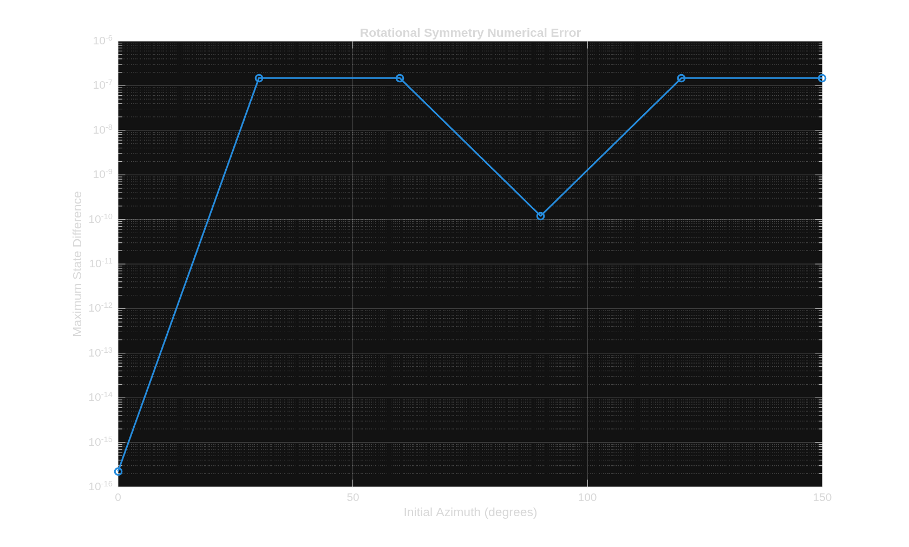

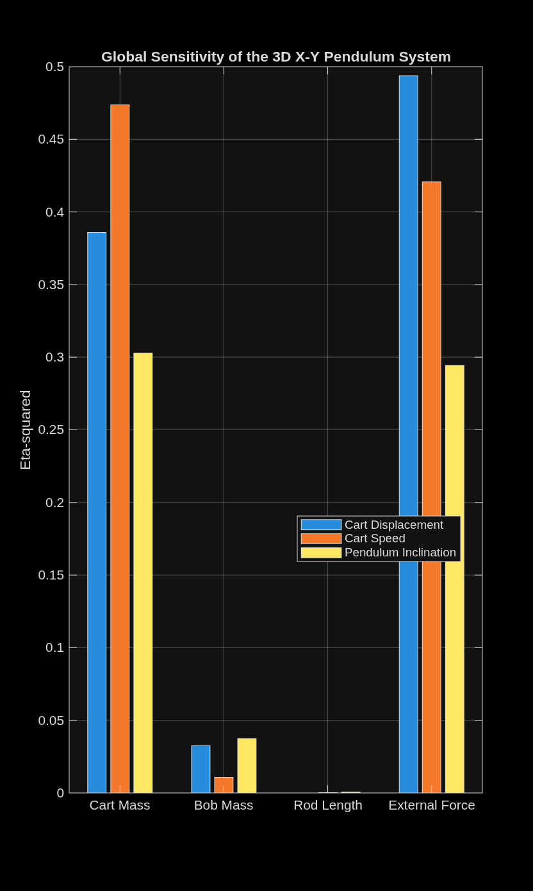

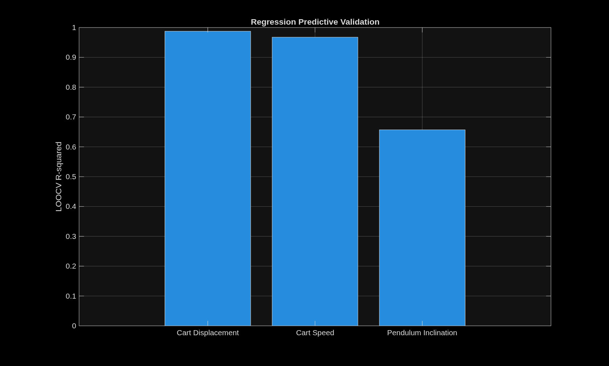

## A.3 LQR control performance

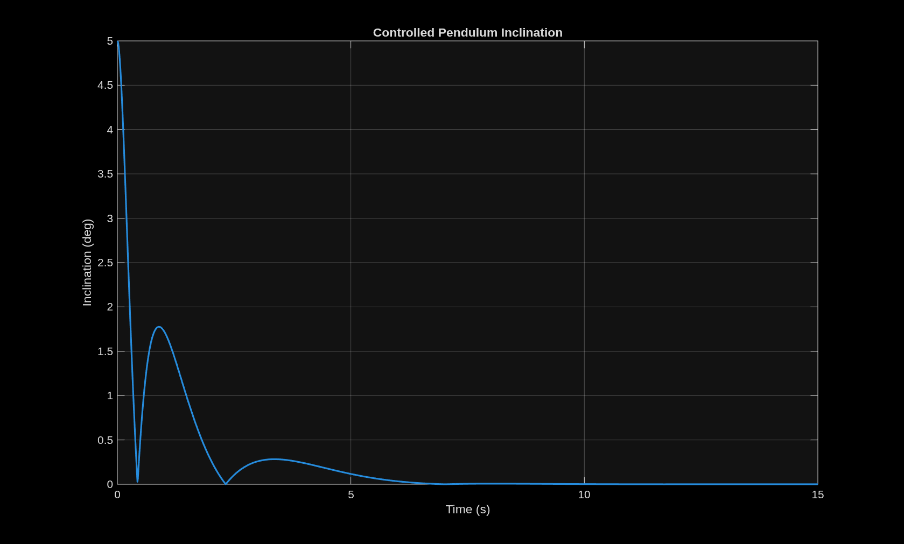

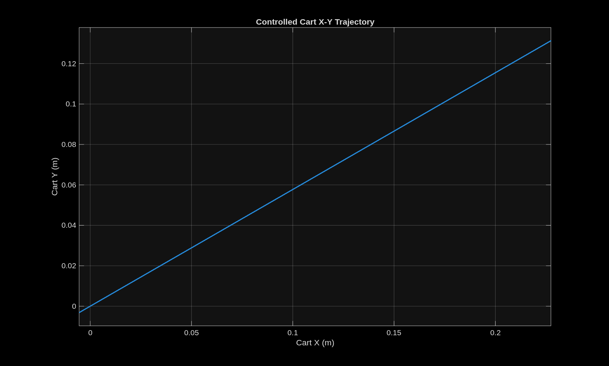

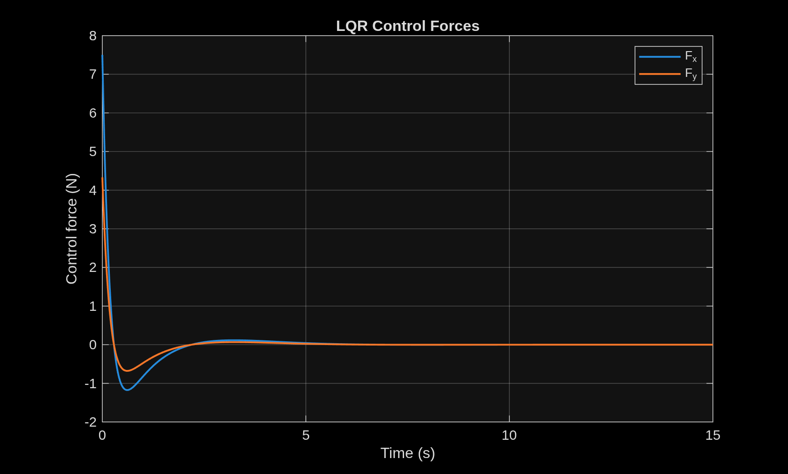

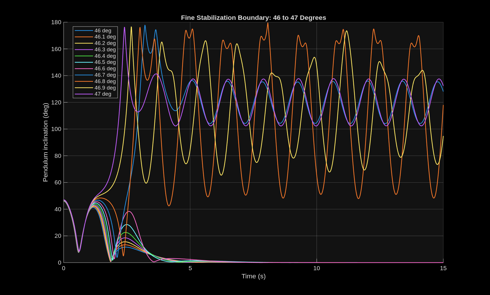

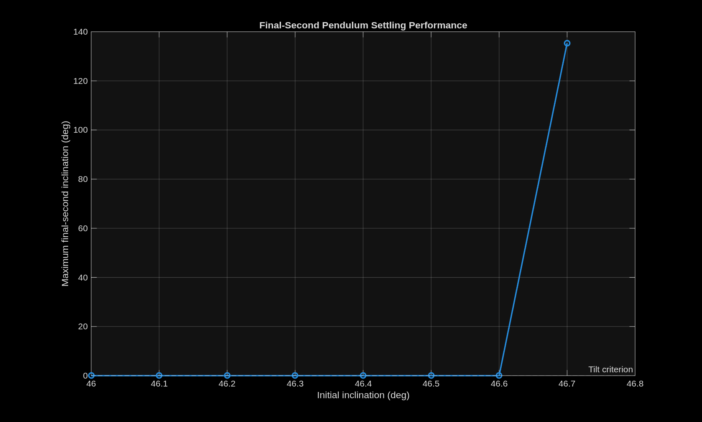

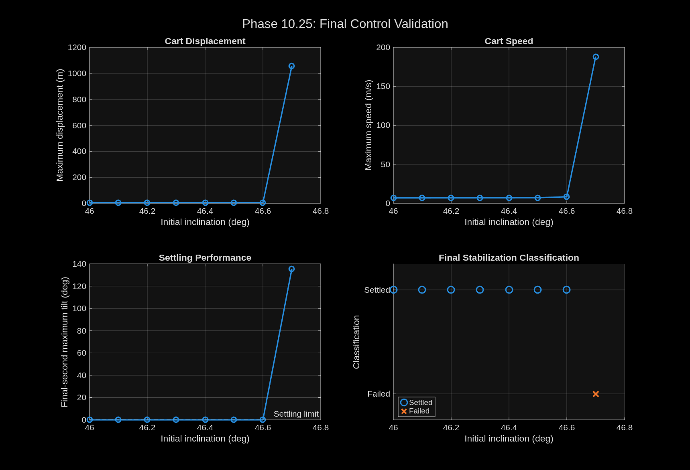

---

**End of Report**
